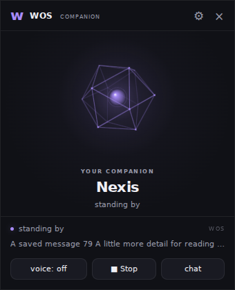
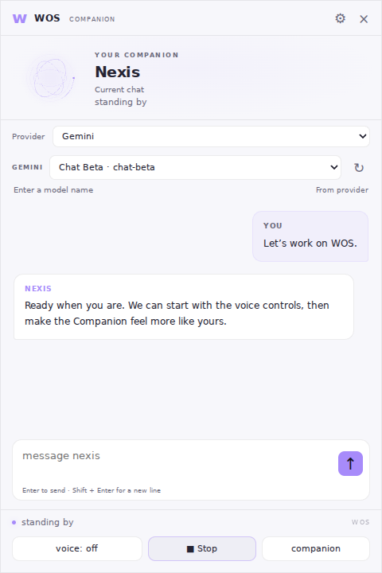

# WOS Companion

The Companion and chat views use the same session, character, models, memories,
chat files, and voice player as the terminal.

## Run

```text
pip install -r requirements.txt
run.bat
```

`run.bat --browser` opens the browser version. Without pywebview, WOS falls back
to your browser automatically. `python start.py` still runs the terminal alone.

## Companion and chat

- Drag the dedicated header to move the desktop window. Message text remains selectable.
- Resize with the bottom-right grip or the native window edges. Each view remembers
  its own dimensions and position, and restored windows stay on an attached screen.
- **Chat / companion** switches views. Chat supports multiline input, copy buttons,
  earlier-message loading, and preserving your reading position when new replies arrive.
- Enter sends; Shift+Enter adds a line. Drafts survive a temporary disconnect and
  are kept separately for each chat while the window stays open.
- The pin keeps WOS above other windows. Its tooltip explains the current action.
  A failed/timed-out window action shows an error without blocking backend recovery.
  Minimize leaves WOS running.
- Appearance offers **Crystal core**, Orb, Orbit rings, and Waveform, with separate light/dark theme,
  accent, avatar size, glow, and motion controls. Settings save automatically.
  System reduced-motion settings disable geometric motion.
- Crystal core is a hollow, rotating geometric shell with a luminous inner core,
  projected on a 2D canvas. During playback the shell and core expand with the WAV
  loudness envelope, then settle smoothly in silence. Reduced motion keeps the
  geometry still. Existing saved styles are kept: choose **Appearance → Crystal core**
  to try it, or use Reset appearance.

## Voice and stopping

Set `FISH_AUDIO_API_KEY` in `.env` or your environment; never put keys in a chat.
The **voice** switch controls future replies and is remembered in `settings.json`.
Turning it off also stops the current/pending speech. It does not require a
restart. Missing keys and voice failures have explicit status messages.

**Stop**, Escape in the chat input, or terminal `/stop` cancels current and
pending speech without muting future replies. At the terminal's main prompt,
Ctrl+C stops active speech; with no speech active, Ctrl+C exits as before.
Closing the desktop window (including Alt+F4), exiting the terminal, or restarting
also stops speech. A reply that was still being generated when stopped will stay
text-only. A new message interrupts the previous spoken reply.

The status distinguishes **analysing**, **preparing voice**, and **speaking**.
Speech is synthesized as a complete WAV before playback begins; this change does
not introduce streaming TTS or delay text until audio is ready.

## Models

Configure only the provider keys you want in `.env` (copy `.env.txt` first).
Restart WOS after changing keys. Keys are read in Python, never entered in chat.

| Provider | Terminal ID | Environment variable |
|---|---|---|
| Gemini | `cloud` | `GEMINI_API_KEY` |
| OpenAI | `openai` | `OPENAI_API_KEY` |
| Claude | `anthropic` | `ANTHROPIC_API_KEY` |
| OpenRouter | `openrouter` | `OPENROUTER_API_KEY` |
| DeepSeek | `deepseek` | `DEEPSEEK_API_KEY` |
| Grok | `xai` | `XAI_API_KEY` |
| Ollama | `ollama` | Local, no key |

In chat, choose a **Provider**, then choose a model to apply both together. Merely
browsing a provider's models does not change the active chat. A provider marked
"no key" explains which environment variable to configure. Refresh fetches a new
model list. Manual model entry remains available. In the terminal use `/provider`
and `/model` for numbered menus. A newly configured key for the current provider
also opens a model picker at startup.

Discovery handles pagination and caches results for ten minutes, separately for
each provider/key fingerprint. Failed discovery falls back to cached/saved models
with a warning. No plaintext API key is stored in the cache or returned to the UI.
Gemini filters `generateContent`; OpenRouter filters for text output and uses the
key's provider preferences. OpenAI hides obvious audio/image/embedding/Codex-only
models. Model metadata does not always specify Chat Completions compatibility:
listing a model does not guarantee text chat support, account access, quota, or
credits. Rejected models show a provider error; select another text chat model.
Ollama lists installed models. No automatic paid fallback is performed.

Changes affect only the current chat. `/defaults provider <provider> <model>` sets
new-chat defaults. Chat history and character instructions are retained when
switching providers and will be sent to the selected provider when you send your
next message. Each provider receives only its own API key.

Provider protocols: [OpenAI](https://developers.openai.com/api/reference/resources/chat/subresources/completions/methods/create),
[Claude](https://platform.claude.com/docs/en/api/messages/create),
[OpenRouter](https://openrouter.ai/docs/api/api-reference/chat/send-chat-completion-request),
[DeepSeek](https://api-docs.deepseek.com/api/create-chat-completion),
[Grok](https://docs.x.ai/developers/model-capabilities/legacy/chat-completions).

## Reliability and storage

- Terminal chat/character/model changes refresh the Companion immediately.
- HTTP and native bridge calls have separate timeouts. Backend polling reschedules
  even after a rendering error and continues while endpoint recovery is pending.
  Disconnected controls are disabled and drafts survive reconnects.
- Controlled `/restart` retains the port and token so browser clients reconnect.
  Desktop clients can also read a changed endpoint after a fresh launch.
- Message identifiers prevent duplicate delivery when retrying a lost response in
  the same backend process. These identifiers are not persisted across a full restart.
- Appearance: `data/companion.json`; window geometry: `data/companion_window.json`;
  model discovery: `data/model_catalog*.json`; initial key setup: `data/*_model_setup.json`.
  Chats and credentials are never sent to the UI as configuration files.

The local server is bound to 127.0.0.1. API routes require the private token and
reject foreign hosts/origins. Browser clients cannot discover a fresh token from
the filesystem; after completely closing and relaunching the terminal, reopen
`run.bat --browser` to obtain the new URL.

## Validation

```text
python -m pip install requests python-dotenv
python -m unittest discover -s tests -t .
node --check overlay/web/chat.js
node --check overlay/web/sage.js
node tests/js/chat_harness.js
node tests/js/avatar_harness.js
```

Tests use fake provider responses/audio and temporary data, without real API keys
or paid requests. GitHub Actions runs the Python and JS checks on Linux and Windows.
Optional rendered UI checks:

```text
npm install --no-save playwright@1.62.1
npx playwright install chromium
node tests/browser_smoke.cjs
```

The browser smoke checks use synthetic messages and model metadata. They cover
provider/model selection, rejected/hung native controls, safe retries, literal rendering, scroll/draft preservation,
reconnection, appearance, and small-window layouts. They do not exercise native
Windows dragging, sound hardware, or pywebview's GUI loop. Those require a real
Windows desktop smoke test. Audio animation follows the WAV envelope and estimated
playback duration with 150 ms state polling; it is not sample-accurate.

## Preview

Browser previews with synthetic messages and model names:



